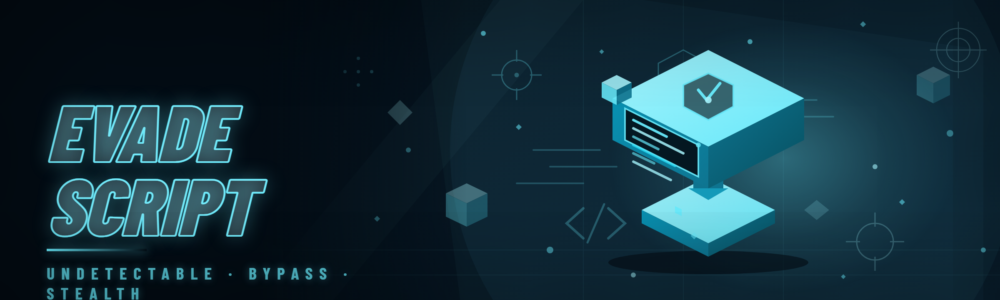

  
  
  

  

  
  

---

---

## 🕹️ Compatibility Matrix

Before you even think about extracting the archive, check that your setup matches. Evade Script was rebuilt from the ground up in 2026 with an updated injection pipeline, so ancient Roblox builds or stripped-down Windows installs will throw handshake errors on launch.

| OS | Windows Build | Roblox Client | Executor Backend | Status |
|----|---------------|---------------|------------------|--------|
| Windows 11 24H2 | 26100+ | Latest stable | Native | ✅ Fully supported |
| Windows 11 23H2 | 22631+ | Latest stable | Native | ✅ Fully supported |
| Windows 10 22H2 | 19045+ | Latest stable | Native | ✅ Fully supported |
| Windows 10 21H2 | 19044 | Latest stable | Native | ⚠️ Legacy mode only |
| Windows 8.1 | — | Latest stable | Compatibility shim | ❌ Not supported |
| Windows 7 | — | — | — | ❌ Not supported |

> macOS, Linux, mobile — not happening. This is a Win32 loader, same as every other serious Evade Script build on the market.

---

## ❓ FAQ

**1. Is this actually free or is there a paywall hiding somewhere?**
No paywall, no "premium key" gate, no Discord-role requirement. The whole reason `evade-lua-hub` exists is that I got tired of paying $15/month for scripts that broke every Tuesday patch. Everything in the hub is unlocked from the moment the `.exe` finishes extracting.

**2. Will I get banned?**
Any Evade Script carries risk — that's the honest answer. This build ships with an updated detection resistance layer (rebuilt 2026) that handles the common Roblox anti-cheat heuristics, but no script hub on the planet can promise zero bans forever. Use an alt if you care about your main.

**3. Why does my executor throw a "handshake failed" error on launch?**
Ninety-nine percent of the time it's a stale Roblox client. Update Roblox first, then re-run the `.exe`. If it still fails, your antivirus quarantined part of the payload — whitelist the extraction folder.

**4. Do I need to disable my antivirus?**
Most AV engines flag script injectors generically (the "injector" signature is shared across the whole category). Add the extraction folder to your exclusion list rather than disabling protection entirely — you already know why blanket-disabling is a bad habit.

**5. Can I run this alongside other script hubs?**
Not recommended. Two injectors fighting over the same Roblox process handle will cause hangs. Close other hubs before launching this one.

**6. How often does the hub get patched?**
Whenever Roblox pushes a breaking change that kills injection or a major script API. The landing page changelog reflects the latest build — if the hub opens and the script list loads, you're current.

**7. Does this work on Roblox UWP / Microsoft Store version?**
No. The Store version sandboxes process access in a way the injector can't reach. Install the standalone web client from roblox.com.

**8. Where do I report a broken script?**
The Community & Support section below links the issue tracker. Include your Roblox version, Windows build, and the console output — vague reports get closed.

---

## 📖 What is Evade Script — Glossary

If you're new to the scene, here's the vocabulary the community actually uses. No sanitized rewrites.

| Term | Explanation |
|------|-------------|
| **Evade Script** | A Lua script (or collection of scripts) injected into the Roblox client to modify gameplay behavior — typically for the "Evade" game on Roblox, covering ESP, aimbot, speed, and similar modifications. |
| **Executor / Injector** | The native `.exe` that attaches to the Roblox process and loads Lua bytecode into its runtime. This repo ships one. |
| **Hub** | A single interface that bundles multiple scripts behind one loader, so you don't juggle ten separate `.lua` files. |
| **ESP** | Extra Sensory Perception — draws boxes/names/health bars over players through walls. The bread-and-butter wallhack of the Evade scene. |
| **Aimbot** | Auto-aim assist that snaps or smooths your camera toward a target. Configurable FOV and smoothing so it doesn't look like a robot. |
| **Spoofer** | A module that masks or rotates client-identifying information to frustrate server-side flagging. |
| **Bypass** | Code that evades anti-cheat detection heuristics — signature scrubbing, memory obfuscation, hook re-routing. |
| **Walkspeed / JumpPower** | Direct stat modifications to movement speed and jump height. Classic, effective, easy to overdo. |

**Why people run it:**

- One loader for every Evade script instead of ten bookmarks
- Rebuilt 2026 injection pipeline that survives recent client updates
- No subscription, no key system, no "reseller" markup
- Configurable per-module toggles so you tune the cheat to your playstyle
- Console log with clear errors instead of silent failures
- Community-maintained script list that gets pruned when things break

---

## 🎯 Tips for Best Results

- Update Roblox **before** every session — stale clients are the #1 cause of injection failures
- Extract the archive to a folder you own (e.g. `C:\EvadeHub`), never run from inside the `.zip`
- Whitelist the extraction folder in Windows Defender and any third-party AV
- Start with conservative module settings — max walkspeed and instant-kill aimbot get noticed fast
- Use a throwaway account for the first week until you trust your config
- Keep the console visible; the log tells you exactly which module failed to hook
- Close other executors before launching this one
- Re-download after major Roblox patches — the landing page always has the current build

---

## 🤖 AI Integration — 2026 Build

The 2026 rebuild folds in a lightweight on-device assistant layer that reads the loaded script state and helps you tune it. No cloud calls, no telemetry — it runs locally against the hub's own config schema.

- **Natural-language config** — type "smooth aim, 30 FOV, low speed" and the assistant writes the toggles for you
- **Auto-tuning profiles** — the assistant observes your in-game stats and suggests safer aimbot/speed values if you're getting flagged
- **Script explainer** — paste any `.lua` from the hub and get a plain-English breakdown of what each hook does before you run it
- **Patch notes digest** — after a Roblox update, the assistant summarizes which modules broke and which the community already patched
- **Anomaly warnings** — flags modules that are producing repeated errors so you can disable them before a crash

---

## 🧩 Module Reference

19 modules ship in the current build. Grouped by category so you can find what you need without scrolling a wall of toggles.

### **Combat Modules**

- **Aimbot** — configurable FOV, smoothing, and bone targeting (head/torso/nearest)
- **Silent Aim** — server-side aim correction with a visibility check to avoid shooting through walls you can't see
- **Trigger Bot** — fires when your crosshair overlaps a target for a set delay
- **Hitbox Expander** — inflates player hitboxes for easier shots (keep it subtle)

### **Visual Modules**

- **Player ESP** — box, name, distance, and health bars
- **Skeleton ESP** — bone-level outlining through walls
- **Tracer Lines** — snap lines from screen center to tracked targets
- **Item ESP** — highlights objective items and drops on the map
- **Chams** — solid-color player models that render through geometry

### **Movement Modules**

- **Walkspeed** — adjustable stat override with a safety ceiling
- **JumpPower** — height modifier with per-jump cooldown
- **Fly** — free-cam movement with configurable speed
- **No Clip** — pass through map geometry with a toggle key

### **Utility Modules**

- **Spoofer** — rotates client identifiers on reconnect
- **Anti-AFK** — keeps your session alive through idle kicks
- **Auto-Rejoin** — reconnects to the last server after a disconnect
- **Server Hop** — cycles servers when you want a fresh lobby
- **Config Manager** — save/load named profiles for different playstyles
- **Console** — live log of hook status, errors, and module state

### Module Status

| Module | Status | Description |
|--------|--------|-------------|
| Aimbot | ✅ Working | FOV/smoothing/bone target all functional |
| Silent Aim | ✅ Working | Visibility check enabled by default |
| Trigger Bot | ✅ Working | 0–500ms delay configurable |
| Player ESP | ✅ Working | Full box/name/health render |
| Skeleton ESP | ✅ Working | Bone outlining stable |
| Chams | ✅ Working | Through-wall rendering |
| Walkspeed | ✅ Working | Stat override with ceiling |
| Fly | ✅ Working | Free-cam stable |
| No Clip | ✅ Working | Toggle-key based |
| Spoofer | ⚠️ Beta | Reconnect rotation working, session rotation in testing |
| Auto-Rejoin | ✅ Working | Reconnect queue stable |
| Server Hop | ✅ Working | Region filter supported |
| Config Manager | ✅ Working | Named profile save/load |
| Hitbox Expander | ⚠️ Beta | Aggressive settings can desync |
| Anti-AFK | ✅ Working | Reliable idle prevention |
| Item ESP | ✅ Working | Objective + drop highlighting |
| Tracer Lines | ✅ Working | Performance-friendly |
| JumpPower | ✅ Working | Cooldown-protected |
| Console | ✅ Working | Live module log |

  

---

## 🧠 How It Works

The hub is a native Win32 `.exe` that wraps a Lua virtual machine and a process-attachment layer. On launch it enumerates running processes, locates the Roblox client by module signature rather than window title (so renamed clients still get found), and waits for the client's runtime to reach a safe attach point. Once attached, it allocates a page of executable memory inside the target, writes a small bootstrap stub, and hands execution to that stub via a thread hijack. The stub spins up the Lua VM, loads the hub's bundled script bundle, and registers a callback channel back to the loader UI so toggles and config changes propagate in real time without re-injecting. Everything after that — module hooking, ESP drawing, aimbot input synthesis — happens inside the target process, driven by the bundled Lua. The loader itself never contains gameplay logic; it's a transport and UI. This split is why the hub survives client updates better than monolithic old-school injectors: when Roblox changes a signature, only the transport stub needs a patch, not the whole script suite.

---

## 🛡️ Detection / Bypass Status

| Method | Status | Notes |
|---------|--------|-------|
| Signature scan evasion | ✅ Active | Bootstrap stub re-obfuscated per build |
| Memory hook detection | ⚠️ Partial | Aggressive modules leave traces; keep settings conservative |
| Server-side stat validation | ⚠️ Partial | Walkspeed/JumpPower ceilings help; extreme values still flag |
| Client integrity check | ✅ Active | Stub bypasses the common integrity hashes |
| Behavioral heuristics | ⚠️ Partial | No script fully solves this — play sensibly |
| Cloud AV signatures | ✅ Active | Rebuilt 2026 payload still trips generic injector signatures (expected) |
| Reconnect token rotation | ✅ Active | Spoofer module handles this |

> Detection resistance is a moving target. Every entry above is best-effort against the current Roblox anti-cheat build — no guarantees, and you already know why.

---

## 🔧 Known Issues

| Issue | Fix |
|-------|-----|
| Handshake failed on launch | Update Roblox client, then re-run the `.exe` |
| Hub opens but script list is empty | AV quarantined the payload — whitelist the extraction folder |
| Injection hangs at "attaching…" | Close other executors; run as administrator |
| ESP boxes drift after teleport | Toggle the module off/on — cache desync, known issue being tracked |
| Aimbot ignores some targets | Bone target may be set to a limb; switch to head/torso |
| Configs wiped after update | Profiles are version-scoped — re-save after each build |

---

## 💬 Community & Support

- **Issue tracker** — the GitHub issues tab is the primary channel for broken-script reports and feature requests
- **Discussions** — config sharing, module tuning, and general Evade scene chatter
- **Changelog** — pinned on the landing page, updated per build
- **Contribution** — pull requests for new modules or script fixes are welcome if they follow the hub's config schema

If a module breaks after a Roblox patch, open an issue with your client version and console output before assuming the whole hub is dead — usually it's one hook.

  

---

That's the whole pitch. The hub exists because paying a monthly fee for a script that dies every patch cycle is a bad deal, and the free alternatives were either abandoned or wrapped in three layers of key-system nonsense. This is the version I built for myself and cleaned up enough to ship — 19 modules, a rebuilt injection pipeline, and a console that actually tells you what broke. Grab it from the landing page, extract, run the `.exe`, and keep your settings conservative until you know how the current anti-cheat reacts.
